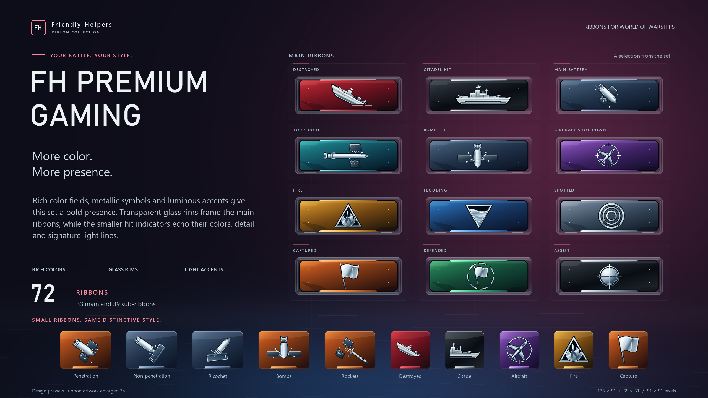

# FH Premium Gaming

**Friendly-Helpers · Ribbon Collection**

Designvorschau für World of Warships · Design showcase for World of Warships

**FH-Version / FH version: 1.0.0 · Stand / Updated: 24.10.2026**

## Deutsch

Kräftige Farbfelder, metallische Symbole und leuchtende Akzente geben diesem Set seinen ausdrucksstarken Look. Transparente Glasränder rahmen die großen Ribbons. Die kleinen Trefferanzeigen greifen Farben, Details und Lichtlinien wieder auf.

Das Set umfasst **72 Grafiken**: 33 Haupt-Ribbons, 25 rechteckige und 14 quadratische Untergrafiken.

Die Vorschau zeigt zwölf Haupt-Ribbons und zehn Untergrafiken, jeweils 3× vergrößert.

### Download und Installation

**FH-Version: 1.0.0.** [FH_Premium_Gaming.zip direkt herunterladen](https://github.com/FeuchterHase/fh-premium-gaming/releases/download/v1.0.0/FH_Premium_Gaming.zip) · [Release v1.0.0](https://github.com/FeuchterHase/fh-premium-gaming/releases/tag/v1.0.0).

Das ZIP enthält 72 PNGs und `INSTALL_DE.txt` / `INSTALL_EN.txt`. Das benannte Release-ZIP verwenden; GitHubs automatische „Source code“-Archive enthalten die Showcase-Dateien.

1. World of Warships vollständig schließen.
2. Den aktiven Modordner öffnen: `WoWS/bin/AKTIVE_BUILDNUMMER/res_mods/`. In `game_info.xml` unter `version name="client", installed` ist die letzte Zahl die Buildnummer. Die Datei nur lesen.
3. Vorhandene eigene Ribbon-Moddateien sichern. Nur einen FH-Stil gleichzeitig verwenden.
4. Das ZIP entpacken und nur seinen Ordner `gui` nach `res_mods` kopieren. Ergebnis: `res_mods/gui/ribbons/` und `res_mods/gui/ribbons/subribbons/`.
5. Spiel starten und Darstellung im Übungsgefecht prüfen.

Spieloriginale in `res`, `idx`, `res_packages` sowie Loader-/XML-Dateien behalten.

**Deinstallation:** Spiel schließen. Nur die aus diesem Paket installierten 72 PNG-Dateien anhand der ZIP-Dateinamen entfernen oder die eigene Sicherung zurückspielen. Andere Mods und Spieloriginale behalten.

### Prüfung und Konflikte

Technischer Ressourcenstand: **World of Warships 15.9.0.0, Build 13357625**. Die 72 Pfade, Maße, RGBA-/Alpha-Eigenschaften und Hashes sind technisch geprüft. Dies ist kein Nachweis, dass alle 72 Gefechtsereignisse einzeln im Spiel getestet wurden. Nach Spielupdates Clientversion, aktiven Modpfad und Paketfassung neu prüfen.

Alle vier FH-Stile belegen dieselben 72 PNG-Pfade und schließen sich gegenseitig aus. Andere Ribbon-Mods mit denselben Pfaden können ebenfalls überschrieben werden. Nur eine Ribbon-Ersetzung für diese Ressourcen auswählen.

Die anderen drei Stile: [FH Clear](https://github.com/FeuchterHase/fh-clear) · [FH Modern Military](https://github.com/FeuchterHase/fh-modern-military) · [FH Naval Heritage](https://github.com/FeuchterHase/fh-naval-heritage).

### Projekt und Kontakt

**Projekt / Autor: Friendly Helpers.** GitHub: [FeuchterHase](https://github.com/FeuchterHase). Discord: [feuchterhase.](https://discord.com/users/554090481093574667).

## English

Rich color fields, metallic symbols and luminous accents give this set a bold presence. Transparent glass rims frame the main ribbons, while the smaller hit indicators echo their colors, detail and signature light lines.

The set contains **72 graphics**: 33 main ribbons, 25 rectangular sub-ribbons and 14 square sub-ribbons.

The preview shows twelve main ribbons and ten sub-ribbons, each enlarged 3×.

### Download and installation

**FH version: 1.0.0.** [Download FH_Premium_Gaming.zip](https://github.com/FeuchterHase/fh-premium-gaming/releases/download/v1.0.0/FH_Premium_Gaming.zip) · [Release v1.0.0](https://github.com/FeuchterHase/fh-premium-gaming/releases/tag/v1.0.0).

The ZIP contains 72 PNGs and `INSTALL_DE.txt` / `INSTALL_EN.txt`. Use the named release ZIP; GitHub's automatic “Source code” archives contain the showcase files.

1. Fully close World of Warships.
2. Open the active mod folder: `WoWS/bin/ACTIVE_BUILD/res_mods/`. In `game_info.xml`, the final number under `version name="client", installed` is the build number. Read this file without editing it.
3. Back up existing ribbon-mod files. Use only one FH style at a time.
4. Extract the ZIP and copy only its `gui` folder into `res_mods`. The result is `res_mods/gui/ribbons/` with `res_mods/gui/ribbons/subribbons/` inside it.
5. Start the game and check the appearance in a training battle.

Keep original files in `res`, `idx` and `res_packages`, and loader/XML files, unchanged.

**Uninstall:** Close the game. Remove only this package's 72 installed PNGs, matching their names against the ZIP, or restore your backup. Keep other mods and original game files.

### Verification and conflicts

Technical resource reference: **World of Warships 15.9.0.0, Build 13357625**. The 72 resource paths, dimensions, RGBA/alpha and hashes were technically checked. This does not establish that all 72 battle events were individually tested in game. After game updates, recheck the client version, active mod path and package version.

All four FH styles use the same 72 PNG paths and are mutually exclusive. Other ribbon mods writing these paths may also be overwritten. Select only one ribbon replacement for these resources.

The other three styles: [FH Clear](https://github.com/FeuchterHase/fh-clear) · [FH Modern Military](https://github.com/FeuchterHase/fh-modern-military) · [FH Naval Heritage](https://github.com/FeuchterHase/fh-naval-heritage).

### Project and contact

**Project / author: Friendly Helpers.** GitHub: [FeuchterHase](https://github.com/FeuchterHase). Discord: [feuchterhase.](https://discord.com/users/554090481093574667).
